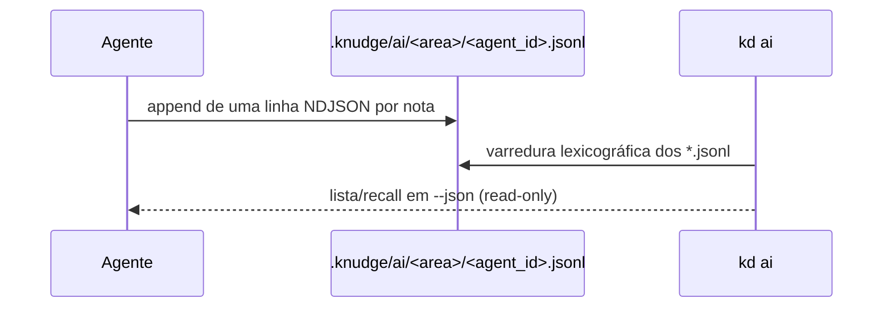

# Integrar a memória de agentes v2 (`kd ai`)

Guia **resumido** para um agente de IA que quer manter a sua memória em shards NDJSON e consultá-la
pelo knudge. É o lado do **escritor** do contrato: o knudge é **read-only**, o agente é o dono do
store. Referências: [`../usage/20_ai.md`](../usage/20_ai.md) (uso),
[`../specs/fontes.md`](../specs/fontes.md) (contrato técnico) e D219–D224.

> **Sem retrocompatibilidade.** O default é `.knudge/ai/<area>/`; `.agents/memory` **não** é lido e
> não existe comando de migração (D224). O agente que já usava o layout antigo deve reescrever os
> seus shards no formato abaixo.

## 1. Fluxo



O agente escreve; o knudge lê, deriva índice/grafo e responde. Nunca há escrita em `notas/` nem em
`.knudge/ai/` pelo knudge.

## 2. Layout e shard

```
.knudge/ai/
  memory/<agent_id>.jsonl        # memória durável (decisões, verificações)
  session-log/<agent_id>.jsonl   # projeção do log (ferramentas, arquivos, comandos, decisão)
  events/                        # reservado; não é lido
```

- **Um shard por `agent_id`** (processo/sessão). O agente principal e cada subagente escrevem no
  próprio ficheiro — nunca num ficheiro compartilhado.
- Nome do shard: use `corpus::shard_file_name` (Rust) ou replique a regra:
  - id seguro (`[A-Za-z0-9._-]`, ≤ 96, ≠ `.`/`..`) → `<agent_id>.jsonl`;
  - caso contrário → `<prefixo-saneado>-<hex8>.jsonl`, com caracteres inseguros → `-`, prefixo ≤ 48
    e `hex8` = 4 primeiros bytes do SHA-256 do id **original**.
  - **Recomendação:** gere um `agent_id` já seguro (`omp-01j...` com ULID/UUIDv7), para o nome ser
    exatamente `<agent_id>.jsonl` e não depender da sanitização.
- O knudge varre apenas o primeiro nível do diretório, em ordem lexicográfica; não há manifesto.
- Resolva os caminhos a partir da **raiz do worktree principal** (a mesma que o `kd ai` usa): se o
  agente corre num worktree ligado, não use `process.cwd()`; consulte `kd ai --json` e use o campo
  `source` (diretório) ou resolva a raiz principal.

## 3. Linha canônica (schema 3)

Uma linha JSON completa + `\n` por nota:

```json
{"frontmatter":{"id":"decision_0a1b2c3d","type":"decision","statement":"Adotamos BTreeMap para dedup determinístico","created_at":1761700000000,"body_hash":"1a2b3c4d","schema_version":3,"tags":["retrieval"],"anchors":["crates/core/src/corpus/source/jsonl.rs"],"provenance":{"activity":"derive","agent":"omp","agent_id":"omp-01j9z6k3","agent_role":"main"}},"body":"Evidência: bench/ai-memory-v2.md\nConsequência: merge O(N log N)."}
```

Campos obrigatórios: `id`, `statement`, `created_at`, `body_hash`, `schema_version` e `type` (exceto
grupo `epic`, derivado de `scope=epic`). Opcionais são **omitidos**, nunca `null` (D05).

### Identidade (`provenance`)

| Campo | Semântica | Obrigatório |
|---|---|---|
| `agent` | nome lógico estável (`omp`) | não |
| `agent_id` | instância (processo/sessão); deve casar com o shard | recomendado |
| `agent_role` | `main` \| `subagent` (enum fechado) | recomendado |
| `parent_agent_id` | id do agente que criou o subagente | em subagente |

`agent_id`/`parent_agent_id`: não vazios, ≤ 128 caracteres, sem caracteres de controlo.
`agent_id` **não** entra no `id` da nota. Defaults de leitura: `agent_id` → `agent` → `"legacy"`;
`agent_role` → `main`; `parent_agent_id` → ausente.

### `id` e `body_hash` (determinísticos)

```
normalize = NFC + trim + colapso de whitespace Unicode
id        = <type>_<base36_8(u32 das 4 primeiras bytes de SHA-256(type + U+001F + normalize(statement)))>
body_hash = hex8(u32 das 4 primeiras bytes de SHA-256(normalize(statement) + "\n" + normalize(body)))
```

O `id` é content-addressed: a mesma afirmação do mesmo tipo tem sempre o mesmo id,
independentemente do agente ou do instante. Dedup entre execuções é feito **na leitura**.

## 4. Escrita determinística

1. **Uma linha completa por nota.** Abra o shard em modo `O_APPEND` e faça uma escrita por nota ou
   por lote do run (`linhas.join("\n") + "\n"`). Nunca reescreva nem trunque o shard.
2. **`created_at` monotónico por agente**, em milissegundos. No mesmo instante, incremente:
   `now = max(Date.now(), last + 1); last = now`. Ao retomar um shard existente (novo processo),
   inicialize `last` com o maior `created_at` já presente no ficheiro — a monotonicidade é por
   `agent_id`, não por processo.
3. **Dedup local do run:** descarte ids repetidos no mesmo lote; entre runs, deixe o knudge aplicar
   “última linha do shard vence”.
4. **Sem lock de leitura.** O knudge pode ler durante o append; uma linha parcial no fim é ignorada
   com warning e entra na leitura seguinte quando o escritor a completa.
5. **`fsync` é opcional** (batch). Sem fsync, um crash pode perder os últimos eventos; nunca corrompe
   linhas completas anteriores.
6. **Não grave segredos nem `thinking`.** O store é durável e consultável; guarde resultado,
   evidência e verificação, com `body` limitado.

### Projeção extrativa (inspirada no `omp-knudge-ai`)

Não peça ao LLM para “decidir o que lembrar”. Derive notas por regras fixas a partir do run
concluído:

| Evento | `statement` | `type` | Destino |
|---|---|---|---|
| Ferramenta usada | `omp usou <tool>` | `fact` | `session-log` |
| Arquivo lido | `omp leu <path>` | `fact` + `anchors` | `session-log` |
| Arquivo escrito/alterado | `omp escreveu/alterou <path>` | `fact` + `anchors` | `session-log` |
| Comando | `comando: <cmd>` | `fact` ou `error` | `session-log` |
| Decisão | primeira frase da resposta final | `decision` | `memory` + `session-log` |
| Verificação | linha de verificação/teste | `fact` | `memory` + `session-log` |

- `session-log` usa `provenance.activity = "derive"`.
- Truncar `statement` (ex.: 120 escalares); deduplicar por `id` no run.
- Flush determinístico em `session_stop`/`agent_end`; se o processo cair antes, o run incompleto não
  é gravado.

## 5. Consulta (`kd ai`)

```bash
kd ai memory --json
kd ai session-log "por que trocamos o embedding" --limit 5 --json
kd ai memory --agent-role subagent --sort time --json
kd ai memory --source /tmp/shards --json
```

- Área posicional: `memory` (default) | `session-log`.
- Sem query → lista (`id|tipo|statement`); com query → recall (`id|statement|score`; vazio →
  `[no_results]`).
- `--sort id|time`; `--agent-id`/`--agent-role`; `--params` define a consulta inteira.
- O envelope é `{success, command, data:{area, source, sort, query, data:{notes|hits}}, warnings?}`.
  Notas/hits trazem `created_at`, `agent`, `agent_id`, `agent_role`, `parent_agent_id`.
- Fonte ausente é **sucesso vazio**; linha malformada vem em `warnings[]`, nunca derruba a leitura.
- Para filtrar `notas/` canónicas por identidade, use `kd ask --agent-id/--agent-role`.

## 6. Migrar o plugin antigo (`.agents/memory`)

Se o agente seguia o layout antigo (um único `notes.jsonl`/`session-log.jsonl`), a mudança é
mecânica e **sem comando do knudge**:

| Antes (v1) | Agora (v2) |
|---|---|
| `.agents/memory/notes.jsonl` | `.knudge/ai/memory/<agent_id>.jsonl` |
| `.agents/memory/session-log.jsonl` | `.knudge/ai/session-log/<agent_id>.jsonl` |
| `schema_version: 2` | `schema_version: 3` |
| `provenance: {activity, agent}` | + `agent_id`, `agent_role`, `parent_agent_id` |
| `DEFAULT_MEMORY_SOURCES` com ficheiros | defaults com **diretórios** |
| escrita num ficheiro compartilhado | um shard por `agent_id`, append por evento |
| `Date.now()` sem monotonicidade | `created_at` monotónico por agente |
| consulta sem `--sort`/identidade | `--sort`, `--agent-id`, `--agent-role` |

Fluxo de migração do agente: ler o store antigo, reconstruir cada nota (ou reaproveitar o JSONL),
acrescentar proveniência ausente e escrever os shards novos com `*.tmp` + rename/append. O knudge
**não** move, copia nem apaga ficheiros do agente.

## 7. Checklist de integração

- [ ] O agente gera um `agent_id` seguro e estável por processo/sessão; subagentes têm o seu.
- [ ] O shard é `.knudge/ai/<area>/<agent_id>.jsonl`, criado com `mkdir -p`.
- [ ] Cada linha é JSON completo + `\n`, escrita em append; nenhuma reescrita/truncagem.
- [ ] `created_at` em ms, monotónico por agente.
- [ ] `provenance` inclui `agent_id`, `agent_role` (e `parent_agent_id` em subagente).
- [ ] `schema_version = 3`; `id`/`body_hash` seguem `normalize` e SHA-256 truncado.
- [ ] `session-log` usa `activity=derive`; `memory` só guarda decisão/verificação.
- [ ] Sem `thinking` e sem segredos; `body` limitado.
- [ ] Consulta via `kd ai --json`; parse do envelope e `warnings[]`.
- [ ] Smoke: o shard aparece em `kd ai`, filtra por `--agent-id`, ordena com `--sort time` e
      sobrevive a uma linha parcial/truncada com warning.
- [ ] Nenhum caminho `.agents/memory` no código do agente (D224).
